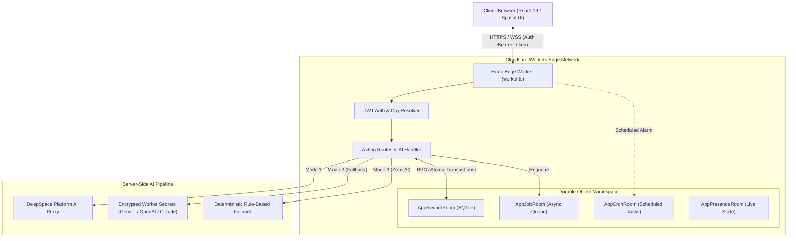
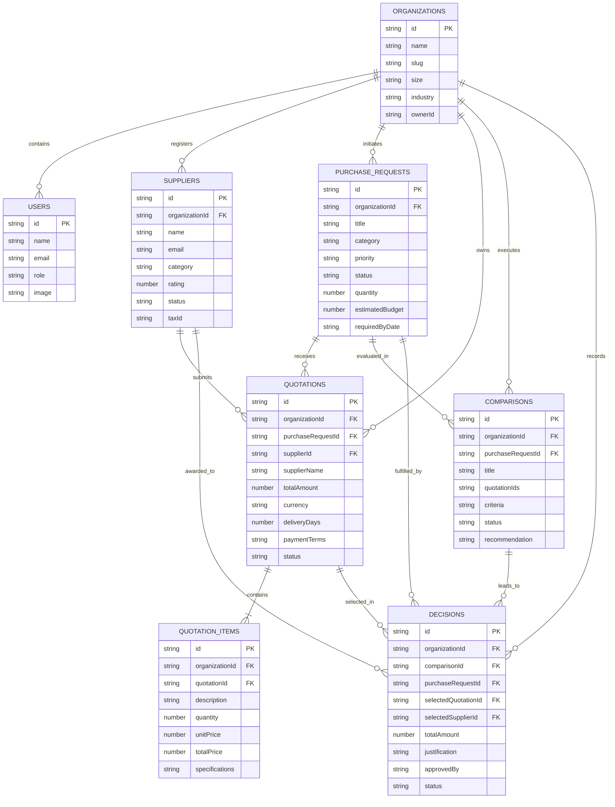

# ProcureLens — Technical Architecture & System Specification

This document provides a comprehensive technical reference for the **ProcureLens** enterprise procurement intelligence platform, detailing the underlying **DeepSpace** platform primitives, multi-tenant security architecture, schema designs for all 8 collections, deterministic scoring algorithms, and AI guardrail isolation layers.

---

## Table of Contents

1. [DeepSpace Platform Primitives & Topology](#1-deepspace-platform-primitives--topology)
   - [Cloudflare Workers & Workers for Platforms](#cloudflare-workers--workers-for-platforms)
   - [Durable Objects Manifest](#durable-objects-manifest)
   - [Embedded SQLite RecordRooms](#embedded-sqlite-recordrooms)
   - [JWT Authentication & Session Resolution](#jwt-authentication--session-resolution)
2. [Security & Isolation Model](#2-security--isolation-model)
   - [Multi-Tenant Data Boundary](#multi-tenant-data-boundary)
   - [Zero-Trust CSV Security & Formula Injection Defense](#zero-trust-csv-security--formula-injection-defense)
   - [Server-Side LLM Isolation & Dual-Mode Execution](#server-side-llm-isolation--dual-mode-execution)
   - [Grounded Epistemic Guardrails](#grounded-epistemic-guardrails)
3. [Data Models & Schema Specification](#3-data-models--schema-specification)
   - [Entity-Relationship Diagram](#entity-relationship-diagram)
   - [Collection 1: organizations](#collection-1-organizations)
   - [Collection 2: users](#collection-2-users)
   - [Collection 3: suppliers](#collection-3-suppliers)
   - [Collection 4: purchase_requests](#collection-4-purchase_requests)
   - [Collection 5: quotations](#collection-5-quotations)
   - [Collection 6: quotation_items](#collection-6-quotation_items)
   - [Collection 7: comparisons](#collection-7-comparisons)
   - [Collection 8: decisions](#collection-8-decisions)
4. [Deterministic Comparison Engine & Scoring Specification](#4-deterministic-comparison-engine--scoring-specification)
   - [Standard 5-Factor Weight Allocation](#standard-5-factor-weight-allocation)
   - [Mathematical Scoring Formulas](#mathematical-scoring-formulas)
   - [Commercial Payment Terms Credit Ladder](#commercial-payment-terms-credit-ladder)
   - [Missing Data & Neutral Score Policy](#missing-data--neutral-score-policy)
   - [Comparability Audit Engine](#comparability-audit-engine)
   - [7-Tier Deterministic Tie-Breaker Hierarchy](#7-tier-deterministic-tie-breaker-hierarchy)

---

## 1. DeepSpace Platform Primitives & Topology

ProcureLens is architected on top of the **DeepSpace SDK** (`deepspace: 0.44.2`), executing within **Cloudflare Workers** utilizing **Durable Objects with embedded SQLite** for state storage.



### Cloudflare Workers & Workers for Platforms
- **Zero Cold-Start Routing**: Built with Hono on the V8 isolate environment, eliminating container startup latency.
- **Static Assets & SPA Prerendering**: Pre-rendered public pages, bots, and single-page application fallback delivered via Cloudflare edge cache (`ASSETS` fetcher).
- **Edge Routing Precedence**: API routes (`/api/*`), WebSockets (`/ws/*`), and dynamic MCP endpoints execute before the static asset pipeline.

### Durable Objects Manifest
The application defines 6 stateful Durable Object classes in `worker.ts`:

```typescript
export const __DO_MANIFEST__ = [
  { binding: 'RECORD_ROOMS', className: 'AppRecordRoom', sqlite: true },
  { binding: 'YJS_ROOMS', className: 'AppYjsRoom', sqlite: true },
  { binding: 'CANVAS_ROOMS', className: 'AppCanvasRoom', sqlite: true },
  { binding: 'PRESENCE_ROOMS', className: 'AppPresenceRoom', sqlite: true },
  { binding: 'CRON_ROOMS', className: 'AppCronRoom', sqlite: true },
  { binding: 'JOB_ROOMS', className: 'AppJobRoom', sqlite: true },
] as const satisfies DOManifest
```

Every room runs an isolated transactional SQLite database, providing ACID guarantees with sub-millisecond local latency.

### Embedded SQLite RecordRooms
`AppRecordRoom` extends DeepSpace's `RecordRoom<Env>`, initializing all 8 domain collection schemas upon isolate boot:
- **ACID Transactions**: Mutations to quotations, items, and purchase requests occur in atomic transactions.
- **Change Broadcasts**: Real-time websocket mutations broadcast state updates across concurrent tabs without requiring a separate message broker.
- **Zero External DB Dependency**: Eliminates reliance on external cloud databases, running entirely inside Cloudflare's distributed edge infrastructure.

### JWT Authentication & Session Resolution
Authentication is handled via asymmetric JWT verification:
- Tokens are verified against `AUTH_JWT_PUBLIC_KEY` issued by `AUTH_JWT_ISSUER`.
- `resolveAuth(c)` verifies the `Authorization: Bearer <token>` header, decodes user identity claims (`userId`, `orgId`), and enforces permission boundaries.
- Debug and privileged endpoints require explicit admin or owner verification (`resolveAppRole`).

---

## 2. Security & Isolation Model

### Multi-Tenant Data Boundary
Multi-tenancy is enforced in depth at both client and server boundaries:
1. **Client Isolation**: The React context (`OrganizationProvider`) tracks the active organization. The `useOrgQuery` hook automatically wraps DeepSpace queries with an immutable filter:
   ```typescript
   // Transparent tenant filter applied to every collection query
   filters: [{ field: 'organizationId', operator: 'eq', value: activeOrgId }]
   ```
2. **Server-Side Boundary Checks**:
   - Every mutation verifying `organizationId` against the caller's JWT claims.
   - Any attempt to create, read, or modify a record belonging to another tenant is blocked with HTTP 403 Forbidden.
3. **Audit Verification**: Verified by `scripts/procurelens_db.py verify-isolation`, which checks the whole database for cross-tenant leakage.

### Zero-Trust CSV Security & Formula Injection Defense
External supplier quotation files are treated as untrusted inputs. `src/lib/csv-security.ts` applies strict multi-layer filtering:

```
[Raw CSV File Upload]
         │
         ▼
[RFC 4180 Parser] ──► Delimiter Detection (Comma, Semicolon, Tab)
         │
         ▼
[CSV Formula Injection Filter]
  • Flags & neutralizes cells starting with: =, +, -, @, \t, \r
  • Strips dangerous prefix to prevent spreadsheet command execution
         │
         ▼
[XSS & Tag Stripping]
  • Removes <script>, <iframe>, HTML tags
  • Neutralizes dangerous protocol schemes: javascript:, data:, vbscript:
         │
         ▼
[Numeric Sanity Verification]
  • Checks for NaN, Infinity, negative values
  • Enforces non-negative constraints: Quantity > 0, Price >= 0, GST in [0, 100]
         │
         ▼
[Tenant Boundary Fence]
  • Ensures incoming organizationId matches active workspace
         │
         ├─── Valid Rows ──────► Staged for Database Mutation
         │
         └─── Rejected Rows ───► Preserved with Row Index & Error Codes
                                 (Downloadable via exportRejectedRowsToCsv)
```

### Server-Side LLM Isolation & Dual-Mode Execution
AI integrations are architected to eliminate key leakage and guarantee uptime:
- **Zero Client-Side Keys**: API keys (`GEMINI_API_KEY`, `OPENAI_API_KEY`, `ANTHROPIC_API_KEY`) are stored in encrypted Cloudflare Worker secrets. The client browser never receives or transmits API credentials.
- **Three-Tier Fallback Hierarchy**:
  1. **Tier 1 (Native Platform Proxy)**: Uses DeepSpace's platform AI binding (`streamDeepSpaceAgent`).
  2. **Tier 2 (External LLM Fallback)**: Direct server-to-server HTTPS call to Google Gemini, OpenAI, or Anthropic using Worker environment bindings.
  3. **Tier 3 (Zero-AI Rule Engine)**: Deterministic analytical fallback generated from raw comparison numbers when network or quota limits are reached.

### Grounded Epistemic Guardrails
To prevent hallucinations in purchasing recommendations:
- **Strict Epistemic Markers**:
  - `[FACT]`: Statements directly backed by calculated metrics (e.g. costs, days, rankings).
  - `[SUGGESTION]`: Strategic procurement recommendations (e.g. volume discount targets).
  - `[RISK]`: Identified risks (e.g. sole supplier exposure, blacklisted status, price divergence).
- **Non-Autonomous Principle**: System prompts explicitly instruct models:
  > *"You are an analytical advisor. You have NO AUTHORITY to approve purchase orders, sign contracts, or allocate corporate budget. Every recommendation requires explicit human operator authorization."*

---

## 3. Data Models & Schema Specification

### Entity-Relationship Diagram



---

### Collection 1: `organizations`
Represents the top-level tenant entity in ProcureLens.

| Column | Type | Interpretation | Constraints / Options | Description |
| :--- | :--- | :--- | :--- | :--- |
| `name` | `text` | plain | Required | Company or department name |
| `slug` | `text` | plain | Required, Unique | URL-safe alphanumeric slug |
| `description` | `text` | plain | Optional | Organization description |
| `industry` | `text` | plain | Optional | Commercial sector |
| `size` | `text` | select | `['1-10', '11-50', '51-200', '201-500', '500+']` | Headcount bracket |
| `ownerId` | `text` | plain | Optional | User ID of tenant creator |

**Permissions**:
- Viewer: No access.
- Member: Read all, create, update own.
- Admin: Full CRUD.

---

### Collection 2: `users`
Represents user profiles and assigned application roles.

| Column | Type | Interpretation | Description |
| :--- | :--- | :--- | :--- |
| `name` | `text` | plain | Full user display name |
| `email` | `text` | plain | User email address |
| `role` | `text` | select (`admin`, `member`, `viewer`) | System-wide authority tier |
| `image` | `text` | plain | Avatar URL |

**Permissions**:
- Viewer / Member: Read own, update own.
- Admin: Read all, update all, delete.

---

### Collection 3: `suppliers`
Maintains the vendor directory, performance ratings, and compliance status.

| Column | Type | Interpretation | Constraints / Options | Description |
| :--- | :--- | :--- | :--- | :--- |
| `organizationId` | `text` | plain | Required | Tenant ownership reference |
| `name` | `text` | plain | Required | Supplier trading name |
| `email` | `text` | plain | Required | Supplier business email |
| `phone` | `text` | plain | Optional | Phone number |
| `address` | `text` | plain | Optional | Physical / billing address |
| `category` | `text` | plain | Optional | Supply category (e.g. IT, Hardware) |
| `rating` | `number`| plain | Range: `[0.0, 5.0]` | Quality performance score |
| `status` | `text` | select | `['active', 'inactive', 'blacklisted']` | Vendor trading status |
| `notes` | `text` | plain | Optional | Internal procurement notes |
| `contactPerson` | `text` | plain | Optional | Primary vendor representative |
| `website` | `text` | plain | Optional | Corporate URL |
| `taxId` | `text` | plain | Optional | VAT / GST / EIN identifier |

---

### Collection 4: `purchase_requests`
Internal requisitions that initiate the vendor bidding workflow.

| Column | Type | Interpretation | Constraints / Options | Description |
| :--- | :--- | :--- | :--- | :--- |
| `organizationId` | `text` | plain | Required | Tenant ownership reference |
| `title` | `text` | plain | Required | Requisition summary |
| `description` | `text` | plain | Optional | Detailed technical scope |
| `category` | `text` | plain | Optional | Requisition category |
| `priority` | `text` | select | `['low', 'medium', 'high', 'urgent']` | Urgency tier |
| `status` | `text` | select | `['draft', 'pending', 'approved', 'in_progress', 'completed', 'cancelled']` | Lifecycle state |
| `quantity` | `number`| plain | $> 0$ | Desired product quantity |
| `unit` | `text` | plain | Optional | Standard unit of measurement |
| `estimatedBudget`| `number`| plain | $\ge 0$ | Authorised target budget |
| `requiredByDate`| `text` | plain | ISO 8601 | Required delivery deadline |
| `requestedBy` | `text` | plain | Optional | Requester name or ID |
| `approvedBy` | `text` | plain | Optional | Budget approver name or ID |
| `notes` | `text` | plain | Optional | Contextual notes |

---

### Collection 5: `quotations`
Aggregates commercial bids submitted by suppliers for a given purchase request.

| Column | Type | Interpretation | Constraints / Options | Description |
| :--- | :--- | :--- | :--- | :--- |
| `organizationId` | `text` | plain | Required | Tenant ownership reference |
| `purchaseRequestId` | `text`| plain | Required | Parent purchase request reference |
| `supplierId` | `text` | plain | Required | Submitting supplier reference |
| `supplierName` | `text` | plain | Optional | Denormalized supplier name |
| `totalAmount` | `number`| plain | Required, $\ge 0$ | Total cost (items + tax + delivery) |
| `currency` | `text` | plain | ISO 4217 (USD, EUR...) | Commercial currency |
| `validUntil` | `text` | plain | ISO 8601 | Quotation expiry date |
| `deliveryDays` | `number`| plain | $\ge 0$ | Promised lead time in days |
| `paymentTerms` | `text` | plain | Optional | e.g. Net 30, Net 60, Advance |
| `status` | `text` | select | `['draft', 'submitted', 'under_review', 'accepted', 'rejected']` | Quotation review status |
| `notes` | `text` | plain | Optional | Commercial conditions |

---

### Collection 6: `quotation_items`
Itemized line products detailing pricing, tax, and specifications for each quotation.

| Column | Type | Interpretation | Constraints / Options | Description |
| :--- | :--- | :--- | :--- | :--- |
| `organizationId` | `text` | plain | Required | Tenant ownership reference |
| `quotationId` | `text` | plain | Required | Parent quotation reference |
| `description` | `text` | plain | Required | Item description / SKU |
| `quantity` | `number`| plain | Required, $> 0$ | Quoted quantity |
| `unitPrice` | `number`| plain | Required, $\ge 0$ | Base price per unit |
| `totalPrice` | `number`| plain | $\ge 0$ | Calculated item total |
| `unit` | `text` | plain | Optional | Item unit (e.g. pcs, kg, hrs) |
| `specifications` | `text` | plain | Optional / JSON | Technical metadata / specs |

---

### Collection 7: `comparisons`
Persists the results, scores, and serialized matrix generated by the comparison engine.

| Column | Type | Interpretation | Constraints / Options | Description |
| :--- | :--- | :--- | :--- | :--- |
| `organizationId` | `text` | plain | Required | Tenant ownership reference |
| `purchaseRequestId` | `text`| plain | Required | Evaluated purchase request |
| `title` | `text` | plain | Required | Comparison evaluation title |
| `quotationIds` | `text` | plain | Comma-separated | IDs of evaluated quotations |
| `criteria` | `text` | plain | JSON string | Serialized weightings & options |
| `status` | `text` | select | `['in_progress', 'completed']` | Evaluation status |
| `recommendation` | `text`| plain | Optional | Winner summary & metrics |
| `notes` | `text` | plain | Optional | Committee review comments |

---

### Collection 8: `decisions`
Formal, audited procurement awards recording the winning vendor and executive rationale.

| Column | Type | Interpretation | Constraints / Options | Description |
| :--- | :--- | :--- | :--- | :--- |
| `organizationId` | `text` | plain | Required | Tenant ownership reference |
| `comparisonId` | `text` | plain | Required | Preceding comparison ID |
| `purchaseRequestId` | `text`| plain | Required | Fulfilled purchase request |
| `selectedQuotationId`| `text`| plain | Required | Selected commercial quote |
| `selectedSupplierId` | `text`| plain | Required | Winning vendor ID |
| `selectedSupplierName`| `text`| plain | Optional | Denormalized vendor name |
| `totalAmount` | `number`| plain | $\ge 0$ | Approved total expenditure |
| `justification` | `text` | plain | Required | Business / audit rationale |
| `approvedBy` | `text` | plain | Required | Authorising officer name / ID |
| `status` | `text` | select | `['pending', 'approved', 'rejected']` | Decision approval state |

---

## 4. Deterministic Comparison Engine & Scoring Specification

The comparison engine (`src/lib/vendor-comparison-engine.ts`) is **100% deterministic and contains zero AI generation**. Every score is reproducible and mathematically verifiable.

### Standard 5-Factor Weight Allocation

| Evaluation Factor | Key | Weight | Default Share | Directionality |
| :--- | :--- | :--- | :--- | :--- |
| **Total Cost** | `cost` | $0.40$ | $40.0\%$ | Lower is better |
| **Delivery Lead Time** | `delivery` | $0.25$ | $25.0\%$ | Lower is better |
| **Quality Rating** | `quality` | $0.20$ | $20.0\%$ | Higher is better |
| **Payment Terms** | `paymentTerms` | $0.10$ | $10.0\%$ | Higher is better |
| **Supplier Reliability** | `reliability` | $0.05$ | $5.0\%$ | Higher is better |

$$\sum W_i = 0.40 + 0.25 + 0.20 + 0.10 + 0.05 = 1.00 \quad (100\%)$$

---

### Mathematical Scoring Formulas

#### 1. Total Purchase Cost ($40\%$)
The benchmark is set to the lowest total purchase cost among all evaluated quotations:
$$\text{Cost Score} = \left( \frac{\min(\text{Costs})}{\text{Vendor Total Cost}} \right) \times 100$$
- If a vendor has missing pricing, their cost score is strictly `0.00` points.

#### 2. Delivery Lead Time ($25\%$)
The benchmark is set to the fastest delivery lead time:
- Standard case ($\min(\text{Days}) > 0$):
  $$\text{Delivery Score} = \left( \frac{\min(\text{Days})}{\text{Vendor Delivery Days}} \right) \times 100$$
- Same-day delivery benchmark ($\min(\text{Days}) = 0$):
  - Same-day vendor ($0\text{ days}$): `100.00` points.
  - Other vendors ($d > 0$):
    $$\text{Delivery Score} = \left( \frac{1}{d + 1} \right) \times 100$$

#### 3. Quality Rating ($20\%$)
Derived from supplier performance history on a standard $0.0$ to $5.0$ scale:
$$\text{Quality Score} = \left( \frac{\text{Rating}}{5.0} \right) \times 100$$

#### 4. Supplier Reliability ($5\%$)
- If supplier status is `blacklisted`, score is immediately clamped to `0.00`.
- Otherwise, calculated as:
  $$\text{Reliability Score} = (\text{On-Time Delivery Rate} \times 0.70) + \left(\frac{\text{Rating}}{5.0} \times 100 \times 0.30\right)$$

---

### Commercial Payment Terms Credit Ladder

Payment terms are scored using a structured commercial credit ladder reflecting working-capital value:

| Payment Term Category | Nominal Days | Normalized Score | Rationale |
| :--- | :--- | :--- | :--- |
| **Net 90** | $90\text{ days}$ | `100.00` | Maximum buyer liquidity retention |
| **Net 60** | $60\text{ days}$ | `85.00` | Extended credit terms |
| **Net 45** | $45\text{ days}$ | `75.00` | Favorable commercial terms |
| **Net 30** | $30\text{ days}$ | `60.00` | Standard enterprise baseline |
| **Net 15** | $15\text{ days}$ | `45.00` | Short-term credit |
| **Immediate / COD / Net 0** | $0\text{ days}$ | `30.00` | Due on receipt / cash on delivery |
| **Advance / Prepayment** | $-1\text{ days}$ | `15.00` | Buyer bears complete working-capital risk |

#### Split Terms Handling
Terms specifying partial advance payments (e.g., *"40% Advance, 60% on Delivery"*) are dynamically interpolated:
$$\text{Score} = (15.0 \times \text{Advance Share}) + (30.0 \times [1 - \text{Advance Share}])$$

---

### Missing Data & Neutral Score Policy

ProcureLens enforces a zero-fabrication policy:
- **Missing Cost**: Scored as `0.00`. Financial commitments cannot be assumed.
- **Missing Optional Attributes** (Delivery Days, Quality Rating, Payment Terms, Reliability):
  - Assigned a transparent **neutral score of `50.00 / 100`**.
  - Labeled prominently in UI and audit reports as `"Unrated / Missing"`.
  - Disclosed in the methodology modal so operators know the score was not earned.

---

### Comparability Audit Engine

Before ranking vendors, `verifyComparability` validates whether bids can be fairly compared:

1. **Purchase Request Boundary**: Ensures all quotations reference the identical `purchaseRequestId`.
2. **Currency Consistency**: Flags any currency divergence (e.g. USD vs EUR).
3. **Quantity Alignment**: Compares quoted items against PR requirements and cross-vendor volumes.
4. **Unit Canonicalization**: Maps synonyms (`pcs`, `units`, `items`, `ea` $\rightarrow$ `unit`) to detect actual unit discrepancies.
5. **Specification Variance**: Uses token Jaccard similarity across line-item descriptions:
   $$J(A, B) = \frac{|A \cap B|}{|A \cup B|}$$
   Values below $0.25$ trigger a `SPECIFICATION_MISMATCH` warning.

---

### 7-Tier Deterministic Tie-Breaker Hierarchy

When two or more vendors receive identical scores, ties are broken strictly in this sequence:

1. **Higher Final Weighted Score** (0 to 100)
2. **Lower Total Purchase Cost** (Primary procurement objective)
3. **Faster Delivery Lead Time** (Lower delivery days)
4. **Higher Quality Rating** (Historical performance)
5. **Better Payment Terms** (Higher credit ladder score)
6. **Higher Supplier Reliability Score**
7. **Alphabetical Order by Supplier Name, then Quotation ID**

---

*Authored for enterprise procurement operations and architecture compliance.*
